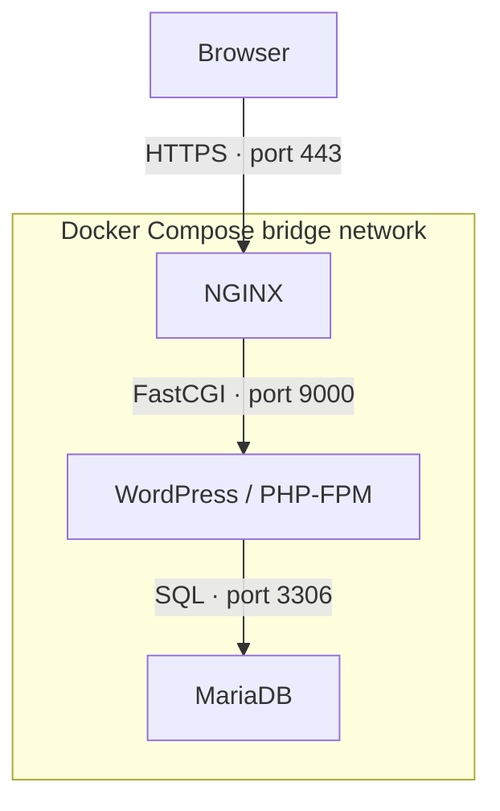

## Overview

Inception is a 42 School system administration project. I built a Docker Compose stack to host WordPress on a Linux machine. The project covers building each service image, routing requests between containers, initializing the application, and keeping data available when containers are replaced.

## Request flow



| Service | Responsibility |
| --- | --- |
| NGINX | Accepts HTTPS with TLS 1.2 or 1.3, serves static files from the shared WordPress volume, and forwards PHP requests to PHP-FPM. |
| WordPress and PHP-FPM | Runs WordPress and handles dynamic requests. The startup script uses WP-CLI to configure the installation and create the initial users. |
| MariaDB | Stores WordPress posts, accounts, and settings. Its entrypoint creates the database and application user if the application database directory is missing. |

I wrote a Dockerfile for each service using Alpine Linux as the base. Compose builds the images and connects the containers on a single bridge network. Docker DNS lets NGINX reach PHP-FPM at `wordpress:9000` even when the container's IP changes. The Compose file publishes only port 443, and HTTPS terminates at NGINX. The FastCGI and database connections stay on the Compose network.

## Startup and persistence

Compose starts MariaDB before WordPress. The database can still be initializing at that point, so the WordPress entrypoint uses `wp db check` before running the installation. The startup scripts check for existing data before initializing it again, then hand off to the foreground service processes.

A container's writable layer goes away when the container is removed. I used two named volumes backed by host directories so the database and WordPress files can survive container replacement. NGINX mounts the WordPress files read only, which lets it serve static assets without writing to the application directory. The backing directories in this checkout are under `/tmp`, so persistence depends on how the host manages those directories.

Compose supplies service settings through an environment file and mounts the password files as secrets. The NGINX image generates a self-signed certificate for the lab environment.

## Local walkthrough

With Docker Compose installed, configure the local hostname and secret files in the project checkout, then build and start the stack:

```sh
mkdir -p /tmp/db_data /tmp/wp_data
make
docker compose -f srcs/docker-compose.yml ps
```

Open the configured HTTPS hostname and create a draft post in WordPress. Run `make down` followed by `make up`, then check that the draft is still there. That exercises the request path and verifies that the database state survives container replacement.
