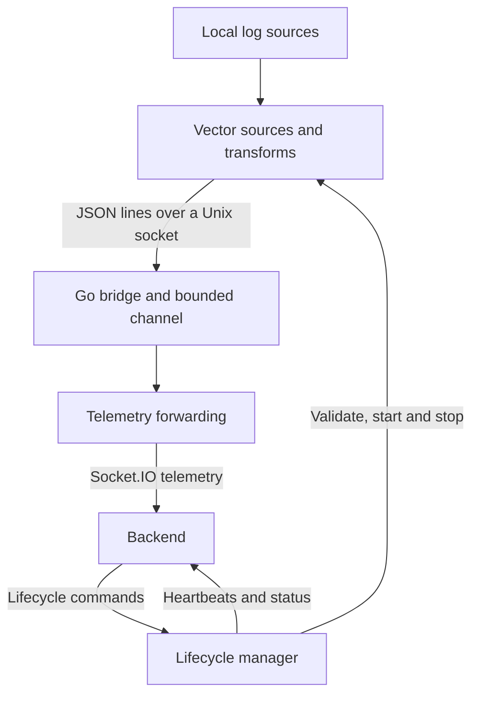

[Download AgentV on GitHub Releases](https://github.com/zakaria-jaddad/agentv/releases) · [Configuration and usage guide](https://github.com/zakaria-jaddad/agentv#readme)

The repository and downloads currently require access to the private GitHub repository.

## Overview

AgentV is a Go service for forwarding host telemetry. It runs alongside nginx, Docker containers, or other sources that Vector can read. Vector collects and transforms the records. AgentV manages that process, forwards its JSON output, reports status, and handles lifecycle commands from the backend.

I built AgentV for [ASSAS](#/project/assas) and packaged it as a separate executable. An operator can install it directly on a monitored Linux or macOS host and configure it for that machine. The backend and analyst console can be deployed separately. AgentV can talk to a backend that implements the same REST and Socket.IO contract.

## Architecture



| Go packages | Responsibility |
| --- | --- |
| `cmd/agentv` and `internal/agentv` | Parse the CLI, discover the hostname and platform, wire dependencies, and handle termination signals. |
| `internal/config` and `internal/vector` | Load YAML, resolve runtime and state paths, generate the Vector configuration, and supervise the child process. |
| `internal/bridge` and `internal/manager` | Accept newline delimited JSON, forward records in order, and coordinate process commands, status reporting, and shutdown. |
| `internal/backend` | Authenticate over HTTP, manage the Socket.IO session, and send telemetry and command acknowledgements. |

Go's standard `flag` package exposes one configuration flag, `-config`, with built-in help through `-h`. The YAML file carries the backend URL and Vector settings. The loader uses Testify's YAML adapter, and `yaml.v3` rewrites the Vector sink path and state directory in a separate runtime file. The installation token comes from `AGENT_TOKEN`. The standard `log` package reports lifecycle events, validation errors, and failed sends.

### Connection and delivery

Go's `net/http` client exchanges the installation token and host metadata for an ID and the Socket.IO namespace URL. The zishang520 Socket.IO Go client opens the namespace after the bridge and command handlers are ready. Temporary HTTP failures back off from two seconds to one minute. Decoded 401 and 403 responses stop retries.

The bridge's 20,000 record channel bounds the number of queued records. When the transport is unavailable, the pipeline retries the current event before reading the next one. If the queue fills, reads from the Unix socket slow down. That preserves order during transient outages. The queue lives in memory, and a successful emit indicates local acceptance by Socket.IO without confirming backend receipt.

Control messages have different requirements. The agent sends a heartbeat every 30 seconds and publishes Vector status snapshots. Lifecycle commands return success or failure through Socket.IO acknowledgements. On shutdown, the manager signals Vector, lets the bridge and pipeline drain within a deadline, and disconnects last.

## Testing and automation

The default Go tests use `testing` and `httptest` to check REST authentication and use injected send functions to exercise retry ordering and cancellation. Socket tests cover command acknowledgements and admission during concurrent requests. Integration tests drive child processes through graceful and forced shutdown, verify the final record can drain from a real Unix socket, and exercise the protocol with a NestJS fixture. The NestJS test requires Node.js and a sibling ASSAS backend checkout with its dependencies installed.

```sh
go test ./...
go test -race -tags=integration ./...
go vet ./...
```

AgentV's GitHub Actions workflow runs on version tags. It verifies that GoReleaser can build the release binaries but has no pull request job for tests, linting, or module checks. The default branch has no required status checks. The Go test suite is the regression check available to contributors before merging or tagging.

## Release engineering

GoReleaser runs in GitHub Actions when a `v*` tag is pushed. The workflow checks out full Git history, selects Go from `go.mod`, and cross compiles the executable with CGO disabled. It strips symbols and debug information, creates a `.tar.gz` archive for each Linux and macOS target on amd64 and arm64, and publishes the archives and `checksums.txt` to GitHub Releases. The published `v0.0.1` release contains all four archives. Operators install Vector and supply their configuration separately.

## Run the agent

1. Install Vector, then download the archive for your OS and CPU and `checksums.txt` from [GitHub Releases](https://github.com/zakaria-jaddad/agentv/releases). For example, on an Apple silicon Mac:

   ```sh
   shasum -a 256 -c --ignore-missing checksums.txt
   tar -xzf agentv_0.0.1_darwin_arm64.tar.gz
   ./agentv -h
   ```

2. Save `agentv.yaml` with the compatible backend base URL and your Vector configuration:

   ```yaml
   version: 1
   backend:
     url: "https://backend.example"
   agent:
     name: "agent-web-01"
   vector:
     binary: "vector"
     config: "./nginx.vector.yaml"
   ```

   The [usage guide](https://github.com/zakaria-jaddad/agentv#configure-and-run) shows how to set up the required Unix socket sink. Export `AGENT_TOKEN` with the installation token issued by the backend, then run:

   ```sh
   ./agentv -config ./agentv.yaml
   ```

3. Confirm in the agent logs that Vector starts and the Socket.IO namespace connects. Produce a benign log record and check that the backend receives it. The [local smoke test](https://github.com/zakaria-jaddad/agentv#local-protocol-smoke-test) shows how to verify receipt with a local file and the NestJS fixture.

**Compatibility:** The published binary sends a `name` field during REST authentication. It works with backends that accept that field, including the local protocol fixture. A strict ASSAS auth DTO that omits `name` rejects the tagged payload.
