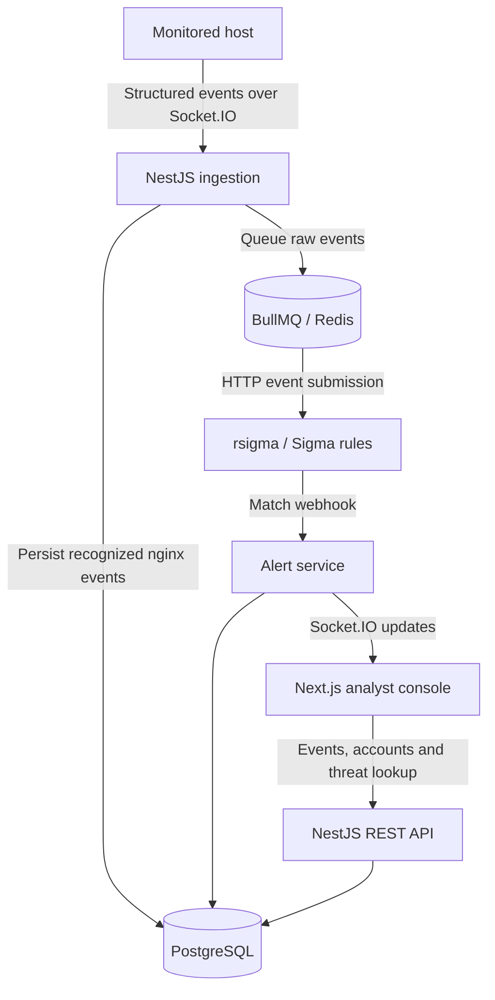

## Overview

ASSAS is a security information and event management (SIEM) platform built by a team of five for 42's ft_transcendence project. It gives an analyst one place to inspect web server logs, triage rule matches, and check whether an indicator of compromise appears in collected events.

## System architecture

| Component | Responsibility |
| --- | --- |
| Accounts and core | NestJS services manage users, roles, teams, and membership. JWT guards and permission checks protect account operations. PostgreSQL stores audit records, and Redis supports token revocation. |
| Event stream and device management | The REST API enrolls installations. A Socket.IO namespace authenticates each connection, associates events with its installation, tracks connection and process state, and routes lifecycle commands. |
| Detection and alert triage | A BullMQ worker submits events to rsigma, which maps nginx fields into Sigma rules. The alert service receives match webhooks, stores alerts, validates lifecycle transitions, and broadcasts new alerts and updates to the console. |
| Threat intelligence and hunting | An indicator registry supports analyst managed entries. The lookup service combines VirusTotal enrichment with searches across collected events to show whether an indicator has already been observed. |
| Analyst console and host integration | Next.js provides the event explorer, alert console, and threat views. [AgentV](#/project/agentv) runs on monitored hosts and supplies the telemetry those views depend on. |

## From host log to analyst view

1. The platform needs a local component because nginx log files and Docker log streams are read on the machines that produce them. [AgentV](#/project/agentv) supervises Vector there. Vector parses and normalizes records with VRL, then passes JSON lines to [AgentV](#/project/agentv) through a Unix socket.
2. [AgentV](#/project/agentv) authenticates over REST and opens the backend's Socket.IO namespace using its installation token and assigned ID. It sends telemetry, heartbeats, and process status over that connection. The same channel carries backend lifecycle commands and their acknowledgements.
3. NestJS queues the raw record for detection before persisting recognized nginx events through Prisma. Keeping detection in a separate worker means ingestion can hand off evaluation without waiting for rsigma to finish. PostgreSQL retains the normalized fields and original event payload for investigation.
4. rsigma evaluates the record against Sigma rules and sends matches to the alert service. Alerts have an explicit state machine for acknowledgement, investigation, resolution, and closure. The events view queries history through REST, while the alert console subscribes to changes over Socket.IO.

## Infrastructure and quality

Docker Compose configures PostgreSQL, Redis, and the rsigma service for development. Detection rules and field mappings are mounted read only. The NestJS backend has its own Docker build definition, and Next.js runs the analyst console. Prisma migrations keep the database schema reproducible.

Backend Jest tests cover event handling, agent protocol behavior, and API response formatting. The repository also contains HTTP tests for accounts and teams. The pull request workflow checks restricted files, validates Prisma migrations against a temporary PostgreSQL service, builds both applications, and checks that each starts. Its backend job runs the Jest suite.

## My contributions

I developed [AgentV](#/project/agentv) and worked across the boundary between host collection and the backend. I implemented the event persistence and BullMQ handoff, connected the worker to rsigma, and added the nginx rule set and field mapping. I also worked on the event explorer and added the restricted file check to the team's pull request workflow.

Two engineering decisions shaped that work. The first was retaining the raw payload alongside indexed fields so an analyst can filter events quickly and still inspect the source record. The second was keeping detection off the ingestion path so the HTTP call to the rules engine runs in a separate worker.

## Walkthrough

In the Events view, select a time range and nginx as the service, then open a record to inspect its normalized fields and raw JSON. Filters are encoded in the URL so another analyst can reopen the same query. The console falls back to sample events when the API is unavailable. In a connected stack, send an ordinary request to a monitored nginx server and confirm the corresponding record in Events.
