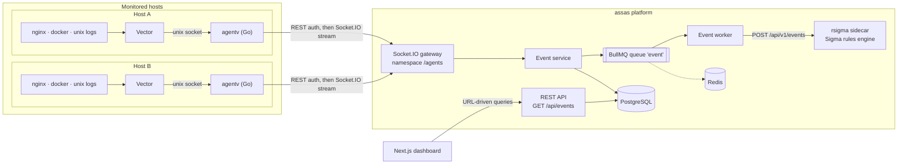
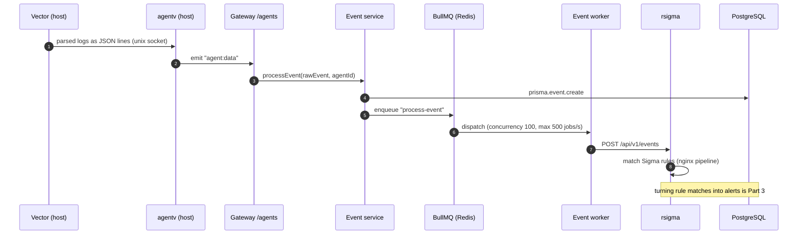
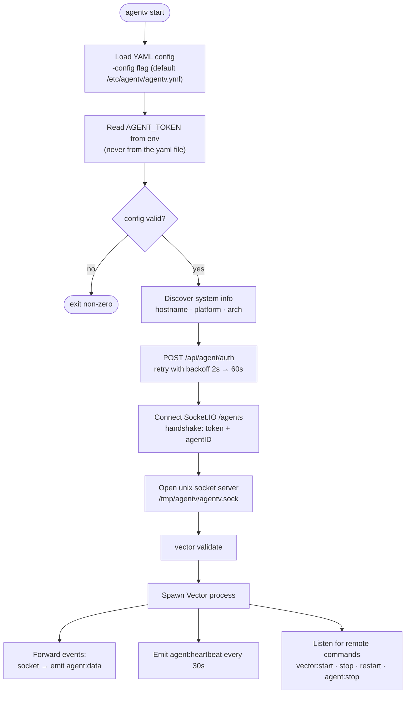
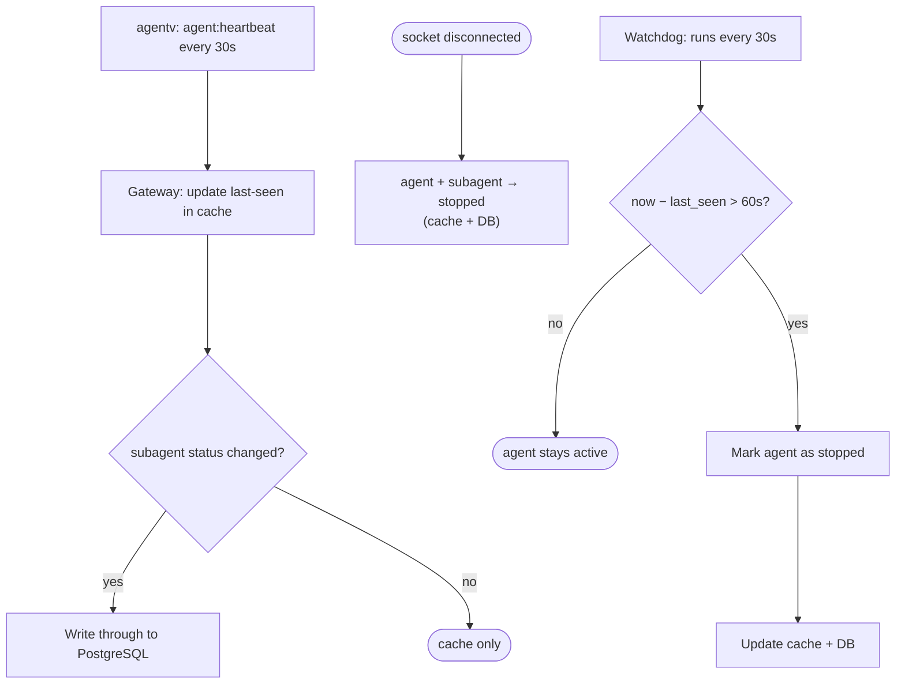
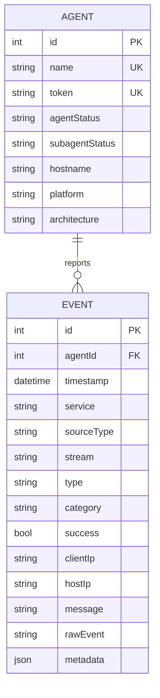
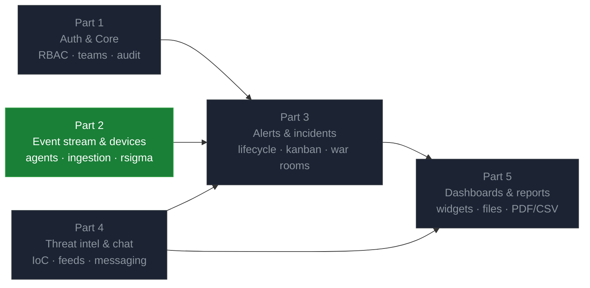

# assas — Modular SIEM / SOC Platform


**assas** is my **ft_transcendence** project: a modular security operations center (SOC) platform — in essence, a small SIEM built from scratch. Lightweight **Go agents** run on monitored hosts, collect and classify logs with **Vector**, and stream structured events in real time over **Socket.IO** to a **NestJS** backend. Events are persisted in **PostgreSQL**, evaluated against **Sigma** detection rules by an **rsigma** sidecar, and explored on a real-time **Next.js** dashboard.

---

## Overview

The platform is designed as five buildable parts, each owning a slice of the data model:

1. **Auth & Core** — admin-provisioned accounts, RBAC, teams, immutable audit logs, WAF middleware, Redis rate limiting.
2. **Event Stream & Device Management** — agent registration, token authentication, event ingestion, real-time broadcast, heartbeat monitoring. *(implemented)*
3. **Alert Engine & Incident Management** — 5-stage alert lifecycle, correlation rules, 6-stage ticket kanban, war rooms.
4. **Threat Intelligence & Chat** — IoC database, feed ingestion (MISP / OTX / STIX-TAXII), real-time team chat and war rooms.
5. **Dashboards, Reports & Agent** — widget-based dashboards, scheduled PDF/CSV reports, file handling, monitoring stack.

Part 2 (the event pipeline) is the foundation that is running today; the remaining parts build on top of it.

---

## Features

### Working today
- **Agent lifecycle management** — agents authenticate once over REST (`POST /api/agent/auth`), then upgrade to a persistent Socket.IO connection guarded by a `token` + `agentID` handshake.
- **Remote agent control** — start / stop / restart the Vector pipeline on any host from the backend (`vstart`, `vstop`, `vrestart`, `astop` commands pushed into per-agent rooms).
- **Log collection pipelines** — Vector sources for **docker container logs**, **nginx access/error logs** and **unix logs**, parsed and normalized with VRL into a single event shape.
- **Event ingestion** — events stream in over the gateway, are stored in PostgreSQL **and** enqueued to BullMQ in parallel for detection evaluation.
- **Sigma-based detection** — an rsigma sidecar evaluates every event against 23 web-attack rules (SQLi, XSS, LFI/RFI, path traversal, webshells, JNDI, suspicious user-agents, CVE-2013-4547, CVE-2017-7529…) through an nginx field-mapping pipeline.
- **Operational event dashboard** — server-rendered Next.js 16 page with **URL-driven, shareable filters** (time range, agent, service, category, type, success, free text), infinite scroll, a slide-out detail panel with JSON tree + raw log, and a deterministic demo dataset when the API is unreachable.
- **Platform conventions** — global response envelope (interceptor + exception filter with Prisma error mapping), Swagger UI at `/api`, argon2 token hashing, Docker Compose for the full stack.

### In progress / planned
- Cursor pagination hardening, real-time push of events to the dashboard.
- Alert ingestion from rsigma rule matches (Part 3), then incidents, threat intel, chat and dashboards (Parts 3–5).

---

## Architecture

### System overview



### End-to-end event pipeline

Every log line travels the same path: parse on the host, stream to the platform, store **and** evaluate in parallel.



### Agent (agentv) lifecycle

The agent boot sequence — from config file to a running Vector pipeline:



### Heartbeat & offline detection

Agents prove liveness every 30 seconds; the gateway keeps the freshest state in cache and only writes through to the database when the status actually changes. A watchdog job (designed on the project board) marks silent agents as stopped.



### Data model

The schema is intentionally small right now — one row per agent, one row per event, indexed for the dashboard's query patterns:



---

## Repository layout

| Path | Stack | Role |
| :--- | :--- | :--- |
| `backend/` | NestJS 11 · Prisma 7 · Socket.IO · BullMQ | REST API + `/agents` gateway, event ingestion, detection worker |
| `frontend/` | Next.js 16 · React 19 · Tailwind v4 | `/events` operational dashboard ("Atlas Night" design system) |
| `agentv/` | Go 1.26 · Vector | Host agent: auth, socket bridge, Vector process manager |
| `rsigma/` | Sigma rules + pipelines | Detection content mounted into the rsigma sidecar |
| `docker-compose.yml` | — | Postgres 17 · Redis 7 · backend · nginx (log fixture) · rsigma |

## Build & Run

### Prerequisites
- Docker & Docker Compose
- Node.js (backend + frontend), Go 1.26+ (agent)
- [Vector](https://vector.dev) installed on hosts running the agent

### 1. Infrastructure
```bash
docker compose up postgres redis   # or the full stack: docker compose up
```

### 2. Backend
```bash
cd backend
npm install
npx prisma migrate dev      # schema → PostgreSQL
npx prisma db seed          # seeds agent-batista (token "hello") & agent-sphynx ("world")
npm run start:dev           # http://localhost:4567 — Swagger at /api
```

### 3. Agent (on each monitored host)
```bash
cd agentv
AGENT_TOKEN=hello go run cmd/agentv/main.go -config agentv-1.dev.yaml
```

### 4. Frontend
```bash
cd frontend
npm install && npm run dev  # http://localhost:3000 → /events
```

### Ports
| Port | Service |
| :--- | :--- |
| `4567` | Backend REST + Socket.IO `/agents` |
| `3000` | Frontend dashboard |
| `5432` | PostgreSQL |
| `6379` | Redis (BullMQ) |
| `8080` | nginx log fixture |
| `9090` | rsigma HTTP input / API |

---

## Branching & workflow

`main` and `dev` are protected (PR + squash merge, CI must pass); work happens on `feat/*`, `fix/*`, `chore/*` branches with conventional commits.

| Branch | Contents |
| :--- | :--- |
| `main` | Initial NestJS scaffold |
| `dev` | Integration branch: agent backend, gateway, BullMQ, event module |
| `feat/agent` | Agent CRUD/auth + nginx event pipelines |
| `feat/event` | Event table rework, rsigma connection, worker logs |
| `feat/event-frontend` | Events dashboard, `GET /api/events` implementation *(current)* |

## Roadmap



The dependency order comes from the foreign keys between tables: alerts need agents, events, users and chat rooms; reports need alerts; files need reports and messages.

---

## What I Learned

- Designing an **agent protocol**: one-shot REST bootstrap → authenticated WebSocket upgrade → local IPC over a unix socket, with heartbeats and remote control.
- **Process supervision in Go**: spawning, monitoring and gracefully stopping Vector (SIGINT → Kill escalation), ordered shutdown on SIGINT/SIGTERM.
- **Real-time backend patterns** with Socket.IO namespaces: handshake middleware auth, per-agent rooms, cache write-through status tracking.
- **High-throughput ingestion** with BullMQ: decoupling storage from detection via a queue with concurrency limits, rate limiting and retries.
- **Detection engineering**: Sigma rules, field-mapping pipelines, and running rsigma as a hardened, read-only sidecar.
- **Log pipeline design** with Vector/VRL: parsing nginx combined/error formats into one normalized, classified event shape.
- **Prisma 7** specifics: the `prisma-client` generator, mandatory driver adapters, seed wiring through `prisma.config.ts`.
- **URL-driven UI state** in Next.js server components: every filter is a shareable query param, with a deterministic in-memory fallback dataset.
- Building a **dark design system** ("Atlas Night") with Tailwind v4 tokens, and enforcing accessibility (severity = icon + label, never color alone).

---

## Author

- [Zakaria Jaddad](https://github.com/zakaria-jaddad)
